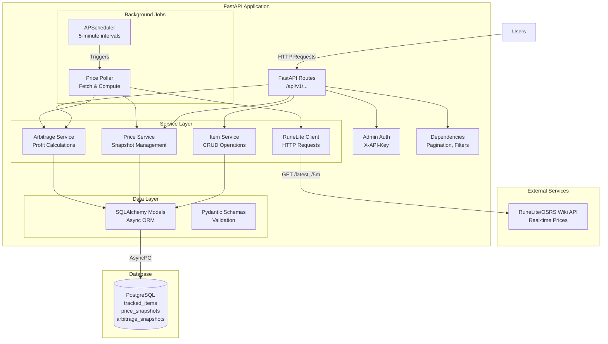
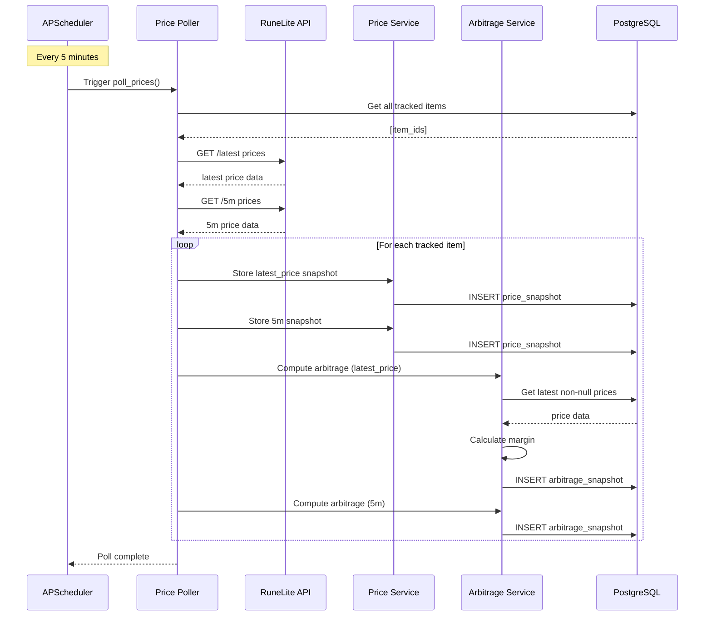
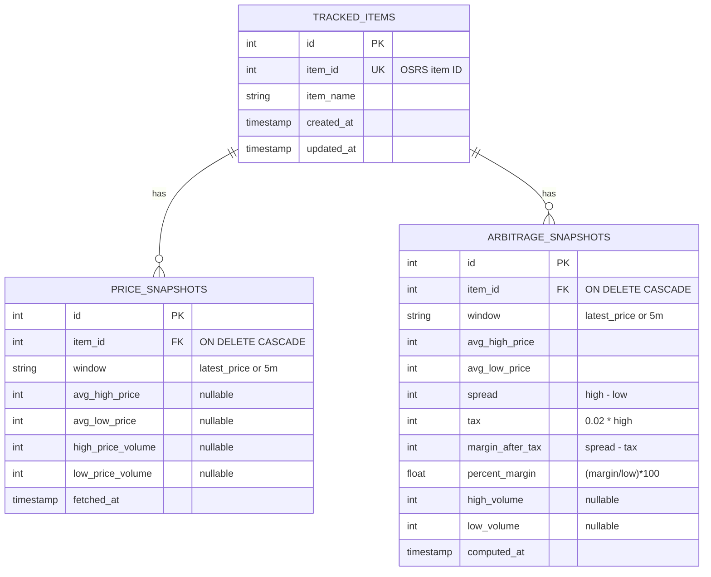

# OSRS Arbitrage Tool

A production-grade FastAPI backend service for identifying profitable trading opportunities in the Old School RuneScape Grand Exchange.

## Project Status

**Current Phase:** Phase 9 (Testing)

**What's Working:**

- Complete project structure with Docker support
- Database models and migrations (Alembic)
- Pydantic schemas for API validation
- RuneLite API client for price fetching
- Full service layer (item, price, arbitrage)
- REST API endpoints (items, arbitrage, admin)
- Background price polling (every 5 minutes)
- Health monitoring with scheduler status

**In Progress:**

- Testing suite
- Documentation refinements

## What is Arbitrage?

**Technical Explanation:**
Arbitrage is the practice of taking advantage of price differences in markets. In OSRS, this involves buying items from the Grand Exchange at a lower price and selling them at a higher price to generate profit.

**Simple Explanation:**
Think of it like buying something on sale and then reselling it for more money. This tool helps find items in the game where you can do that profitably.

## How It Works

**Technical Explanation:**
This backend periodically polls the RuneLite x OSRS Wiki Real-time Prices API every 5 minutes to fetch instant (`latest_price`) and 5-minute average prices for tracked items. It stores historical price snapshots and precomputes arbitrage opportunities using the formula:

```
profit_margin = ((avg_high_price - avg_low_price - (0.02 * avg_high_price)) / avg_low_price) * 100
```

The precomputed results are stored in PostgreSQL for fast retrieval via REST API endpoints.

**Simple Explanation:**
Every 5 minutes, the app checks the prices of OSRS items you're tracking. It calculates how much profit you could make by buying low and selling high (after accounting for the 2% Grand Exchange tax). These profit calculations are saved so the API can show you the best opportunities instantly.

## Quick Start

### Prerequisites

- Docker and Docker Compose (recommended)
- OR Python 3.11+ and PostgreSQL

### Option 1: Docker (Recommended)

```bash
# Clone the repository
git clone <repository-url>
cd osrs-arbitrage

# Set up environment variables
cp .env.example .env
# Edit .env if needed (defaults should work for local dev)

# Start all services
docker compose up

# API will be available at http://localhost:8000
# API docs at http://localhost:8000/docs
```

### Option 2: Local Python Environment

```bash
# Create and activate virtual environment
python -m venv venv
source venv/bin/activate  # On Windows: venv\Scripts\activate

# Install dependencies
pip install -r requirements.txt

# Set up environment variables
cp .env.example .env
# Edit .env with your PostgreSQL connection string

# Run migrations
alembic upgrade head

# Seed initial data
python -m app.utils.seed_data

# Start development server
uvicorn app.main:app --reload
```

## Features

- **Real-time Price Tracking**: Fetches latest GE prices every 5 minutes
- **Precomputed Arbitrage**: All profit calculations done in advance for fast API responses
- **Historical Data**: Stores all price snapshots for trend analysis
- **Null Price Handling**: Gracefully handles missing data from the API
- **Admin Controls**: Protected endpoints for adding/removing items
- **Docker Ready**: Full containerization for easy deployment
- **Production Grade**: Async/await, proper error handling, logging

## API Endpoints

### Public Endpoints

| Method | Endpoint | Description |
|--------|----------|-------------|
| GET | `/api/v1/items` | List all tracked items |
| GET | `/api/v1/items/{item_id}/history` | Price history for specific item |
| GET | `/api/v1/arbitrage/top` | Top arbitrage opportunities |
| GET | `/api/v1/arbitrage/{item_id}` | Arbitrage history for specific item |
| GET | `/health` | Health check with scheduler status |
| GET | `/docs` | Swagger UI documentation |

**Query Parameters:**
- `window`: `latest_price` or `5m` (default: `5m`)
- `limit`: Number of results (default varies by endpoint)
- `min_margin`: Minimum percent margin filter (arbitrage endpoints)

### Admin Endpoints (require X-API-Key header)

| Method | Endpoint | Description |
|--------|----------|-------------|
| POST | `/api/v1/items` | Add item to tracking |
| DELETE | `/api/v1/items/{item_id}` | Remove item from tracking |
| POST | `/api/v1/admin/refresh` | Manually trigger price fetch |

## Technology Stack

- **Backend**: FastAPI (Python 3.11)
- **Database**: PostgreSQL with asyncpg
- **ORM**: SQLAlchemy (async)
- **Migrations**: Alembic
- **Background Jobs**: APScheduler
- **Testing**: pytest + pytest-asyncio
- **Deployment**: Docker + Render

## Initial Tracked Items

The service starts tracking these 5 items by default:

- Coal (ID: 453)
- Iron ore (ID: 440)
- Iron bar (ID: 2351)
- Mithril ore (ID: 447)
- Mithril bar (ID: 2359)

More items can be added via the API once it's running.

## Development Commands

### Docker Commands

```bash
# Start services
docker compose up

# Start in background
docker compose up -d

# View logs
docker compose logs -f api

# Rebuild after code changes
docker compose up --build

# Stop services
docker compose down
```

### Database Commands

```bash
# Create new migration
alembic revision --autogenerate -m "description"

# Apply migrations
alembic upgrade head

# Rollback migration
alembic downgrade -1

# View migration history
alembic history
```

### Testing Commands

```bash
# Run all tests
pytest

# Run with verbose output
pytest -v

# Run specific test
pytest tests/test_services/test_arbitrage_service.py

# Run with coverage
pytest --cov=app
```

## Deployment

This project is configured for deployment on Render using Docker:

1. Connect your GitHub repository to Render
2. Render will automatically detect the `render.yaml` configuration
3. Set the `ADMIN_API_KEY` environment variable in Render dashboard
4. Deploy! Render will build the Docker image and run migrations automatically

The database will be automatically provisioned via Render's PostgreSQL service.

### Production Deployment Checklist

**IMPORTANT: Before deploying to production, update these environment variables:**

1. **CORS_ORIGINS** - Restrict to your frontend domain
   - Dev: `["*"]` (allows all origins)
   - Prod: `["https://your-frontend-domain.com"]`
   - Why: Prevents unauthorized websites from accessing your API

2. **ADMIN_API_KEY** - Use a secure random key
   - Dev: `dev-admin-key-change-in-production`
   - Prod: Generate a cryptographically secure random string
   - Why: Protects admin endpoints from unauthorized access

3. **LOG_LEVEL** - Reduce verbosity
   - Dev: `DEBUG`
   - Prod: `INFO` or `WARNING`
   - Why: Reduces log noise and prevents information leakage

4. **Database credentials** - Ensure strong passwords
   - Render's managed PostgreSQL uses secure credentials by default

## System Architecture

### Component Diagram



### Data Flow Diagram



### Database Schema (Entity Relationship)



**Technical Explanation:**
The system uses a layered architecture with clear separation of concerns. The API layer handles HTTP requests and validation, the service layer implements business logic, and the data layer manages database operations. Background jobs run independently to fetch and process price data.

**Simple Explanation:**
Think of it like a restaurant: The API layer is the waiter taking orders, the service layer is the kitchen preparing food, and the database is the pantry storing ingredients. The background scheduler is like a delivery truck that brings fresh supplies every 5 minutes.

## Changelog

See [CHANGELOG.md](CHANGELOG.md) for a detailed history of changes.
